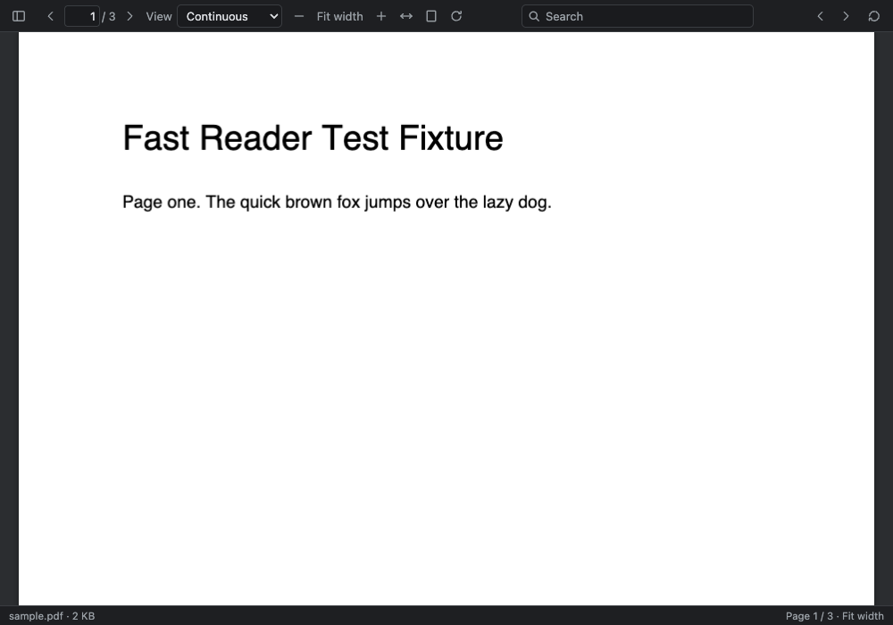
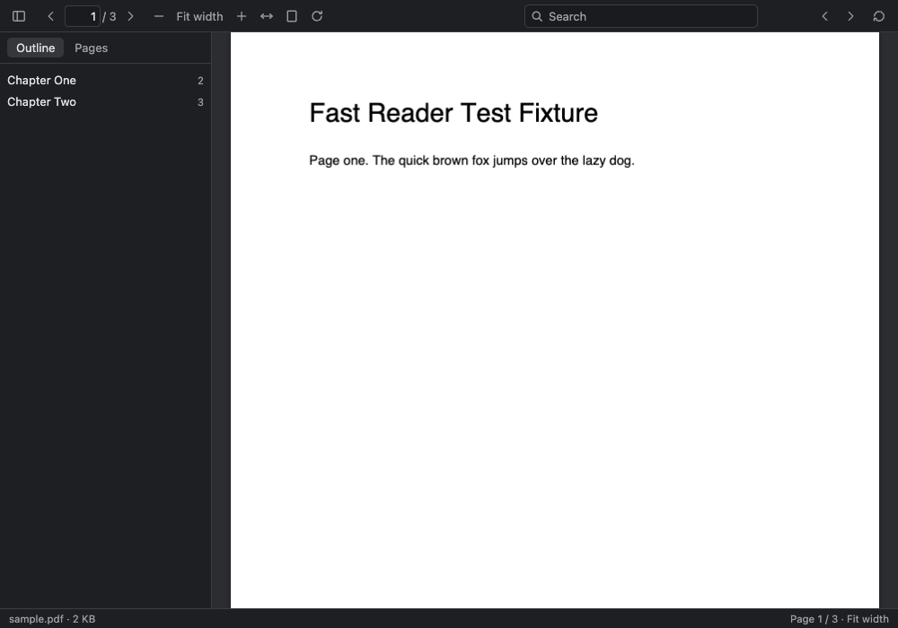
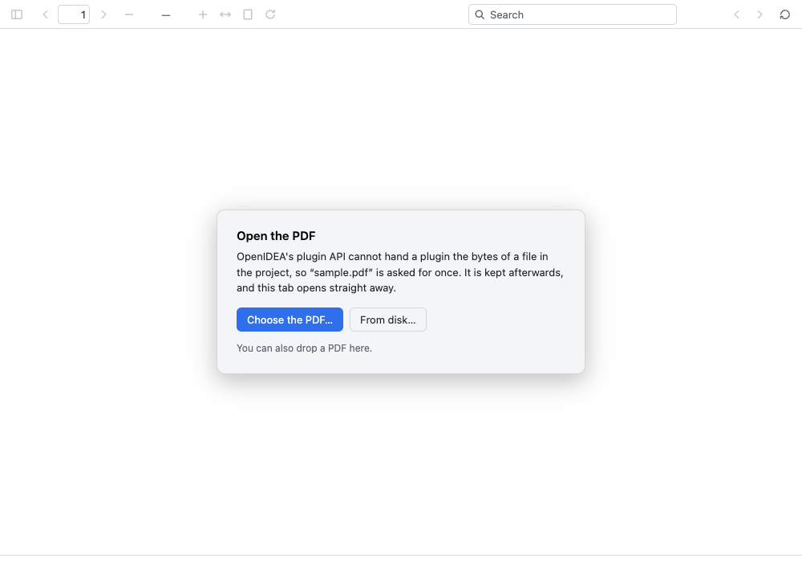

# PDF Viewer for OpenIDEA

A reader for `.pdf` files inside [OpenIDEA](https://github.com/l0ng-ai/openidea).

**OpenIDEA 0.1.43+ opens PDFs with the system's associated application** (Preview
on macOS by default). Its opener runs before contributed editors; this plugin
targets Plugin API 1.7 (OpenIDEA 0.1.44+) as a fallback for configurations that
still route PDFs to contributed editors. If PDFs open in the reader instead,
check **Settings › Editor › File Types › Files opened in associated
applications** and ensure `*.pdf` is listed.



- **Choose how to read.** Single-page, continuous scrolling, or side-by-side
  pages, plus zoom, fit width/page, rotate, and jump to a page.
- **A real text layer.** Select and copy text, follow links, use the document's
  outline or thumbnails to move around.
- **Searches the whole file.** Matches are highlighted, counted, and navigated
  with `Enter` / `Shift+Enter`.
- **Follows the IDE.** Theme colours update with the IDE. pdf.js renders in the
  plugin's sandboxed page; no network and no uploads.
- **Reads project PDFs directly.** OpenIDEA API 1.5's custom-editor
  `document.bytes()` supplies the opened file to the page (up to 64 MiB).
  `project.read-bytes` through the component is a project-confined fallback
  (up to 16 MiB). No path-specific `fs.read` permission is requested.

| | |
| --- | --- |
| Plugin API | `^1.7` (built against OpenIDEA 0.1.44) |
| Capabilities | optional `project.read` (component fallback); direct `document.bytes()` needs no plugin grant |
| Contributions | one custom editor, `*.pdf` |

## Build and try it

```sh
./build.sh                                  # dist/plugin.wasm + web/
rustup update stable                        # the latest OpenIDEA CLI may need a newer Rust
cargo install --locked --git https://github.com/l0ng-ai/openidea ide-host --bin openidea-plugin
openidea-plugin check                      # validate manifest, page and component
openidea-plugin link                       # load this folder
```

Then **Settings › Plugins › Reload**. Open a `.pdf` in a project. For normal
files up to 64 MiB, its bytes go directly from the custom editor to the page,
without a picker or a filesystem-path grant. If that bridge is unavailable, the
component falls back to `project.read-bytes` when the optional `project.read`
capability is granted (16 MiB maximum). If neither route can provide the bytes,
the viewer offers the IDE picker, a browser picker, or drag-and-drop; files
handed in this way are kept in the plugin's private cache for later opens.

`./build.sh --skip-web` rebuilds only the Wasm component. The page alone is
`pnpm --dir web-src install && pnpm --dir web-src run build`.

To install a package rather than link the folder, run `./package.sh`. It creates
`dist/myrrr.pdfviewer-0.1.1.oiplugin` for **Settings › Plugins › Install Plugin
from Package File…**. The package is unsigned, which the install page will note.

## How it works





### Byte sources

The source order in `web-src/src/source.ts` is:

1. **`document.bytes()` (API 1.5).** OpenIDEA passes the exact bytes of the file
   this web custom editor is displaying to the page, read-only, up to 64 MiB.
   The page cannot supply an arbitrary path to this API.
2. **`project.read-bytes` (API 1.5).** If the direct web bridge cannot read the
   file, the page asks the plugin code. It uses the active editor's path and
   `Invocation::project().read_bytes(path)`, so OpenIDEA confines the read to
   the active project. This requires the optional, low-risk `project.read`
   grant, reads the file on disk, and is capped at 16 MiB. The bytes are sent
   to the page in base64 parts because the plugin/view message channel is text.
3. **Text or the private cache.** A valid UTF-8 PDF can be recovered from the
   document text. Files previously selected/dropped are cached under their
   path and name in the plugin's private data directory (`host::fs::plugin_dir`),
   which has no path-wide read permission and is removed on uninstall.
4. **The user.** If bytes are still unavailable, use the IDE's **Choose the
   PDF…** action, the browser's **From disk…**, or drop a file on the reader.
   Picked/dropped PDFs are cached for later opens.

The direct web API can handle larger files than the component method. A file
larger than 64 MiB cannot use `document.bytes()`; `project.read-bytes` only
handles up to 16 MiB. In that case the IDE picker also has its documented
64 MiB limit; browser file selection or drag-and-drop can be used for larger
files, subject to available memory.

### Why there is still a Wasm component

The sandboxed frame cannot read storage or call the project API. The component
provides the page's bounded key-value protocol and private-file cache, reports
the active editor path for cache identity, and implements the optional
`project.read-bytes` fallback. It never reads an arbitrary page-supplied path:
`read` obtains the path from `ctx.editor()`, then passes it to the project's
root-confined `read_bytes` method.

API 1.5's `project.read-bytes` returns exact on-disk bytes; unsaved editor text
does not apply. A PDF custom editor is read-only, so this is appropriate. The
page-first `document.bytes()` route is also read-only and is the normal path.

The cache uses one file per key under the plugin's private directory. Keys have
`/` escaped as `%2F`; PDF bytes are split into 2 MiB chunks. API 1.3's `fs`
interface has no directory-creation or file-removal call, so entries are flat
and delete truncates a cached value to zero bytes. The cache keeps up to 8 PDFs
and 256 MiB, least-recently-used first. Directly-read project PDFs are not
copied into the cache; they are read from the IDE again when opened.

### pdf.js in the sandbox

The page is loaded in an `<iframe sandbox="allow-scripts">`: an opaque origin
with no network or storage of its own. pdf.js uses its main-thread fallback
because the sandbox cannot start a Worker from the plugin URL scheme; the
viewer disables rendering workers too. Character maps, standard fonts, and
image decoders ship in the package and are loaded by relative URL. The smoke
test runs the page inside the same sandboxed frame.

## Tests

```sh
CARGO_HOME="$PWD/.cargo-home" cargo test --locked
pnpm --dir web-src run typecheck
pnpm --dir web-src test
```

Rust tests cover the project-scoped read, binary bytes, and missing
`project.read` permission. The browser smoke test exercises direct
`document.bytes()`, the multipart `project.read-bytes` fallback, the text and
cache paths, and the picker, then checks rendering, text selection, outline,
search, navigation, and thumbnails. It needs Chromium: Playwright's managed
browser, a system Chrome, or `CHROME=/path/to/chrome`.

`fixtures/sample.pdf` is generated by `fixtures/make-sample.py` (three ASCII
pages, two bookmarks).

## Publish and list the plugin

The community registry accepts a package only when it is signed with a
publisher key, attached to a public source-repository release, and pinned by
its SHA-256. The unsigned package from `./package.sh` is for local installation
and testing; do not submit it to the registry.

1. The registry requires a public GitHub source repository. This project is
   staged at `https://github.com/Royshare/openidea-pdfviewer`; make it public
   before submitting the registry PR. The `myrrr` part of `myrrr.pdfviewer` is
   the publisher ID; the publisher's `owners` value must list the GitHub login(s)
   allowed to update it (currently `Royshare`).
2. Create an Ed25519 key once and keep the private key out of this repository
   and out of releases. Back it up securely. The command prints the public key
   for the publisher listing:

   ```sh
   umask 077
   mkdir -p "$HOME/.config/openidea/keys"
   openidea-plugin keygen "$HOME/.config/openidea/keys/myrrr.key"
   ```

   Do not regenerate the key for routine releases. Losing it requires a key
   rotation and maintainer help.
3. Build, validate, sign, and calculate the digest. Use the `openidea-plugin`
   CLI from an OpenIDEA release, or install it with
   `cargo install --locked --git https://github.com/l0ng-ai/openidea ide-host --bin openidea-plugin`:

   ```sh
   ./build.sh
   openidea-plugin check
   openidea-plugin pack . --key "$HOME/.config/openidea/keys/myrrr.key" --publisher myrrr
   shasum -a 256 myrrr.pdfviewer-0.1.1.oiplugin
   ```

   `./package.sh` creates an unsigned local-install package; the signed file
   produced by `openidea-plugin pack` is the one to release and list.
4. Create a GitHub release tagged `v0.1.1` in the source repository and attach
   the signed `.oiplugin` file. Keep the tag, release asset, manifest version,
   and registry `version` identical.
5. Open a first-time publisher/plugin pull request in
   [l0ng-ai/openidea-plugins](https://github.com/l0ng-ai/openidea-plugins). Add
   both `publishers/myrrr.toml` and `plugins/myrrr.pdfviewer.toml`. Replace the
   public-key and SHA-256 examples below with the real values; never put the
   private key in either file.

   `publishers/myrrr.toml`:

   ```toml
   name = "MyRRR"
   owners = ["Royshare"]
   keys = ["<base64 public key printed by keygen>"]
   revoked-keys = []
   ```

   `plugins/myrrr.pdfviewer.toml`:

   ```toml
   repository = "https://github.com/Royshare/openidea-pdfviewer"

   [[versions]]
   version = "0.1.1"
   package = "https://github.com/Royshare/openidea-pdfviewer/releases/download/v0.1.1/myrrr.pdfviewer-0.1.1.oiplugin"
   sha256 = "<64-character SHA-256 of the signed package>"
   ```

New publishers and plugins are reviewed by a registry maintainer. Registry CI
checks the package digest, manifest, and signature; after the PR is merged, the
community index is normally updated within an hour. See the registry's
[publishing instructions and rules](https://github.com/l0ng-ai/openidea-plugins#publishing-a-plugin).

The `project.read` capability remains optional and is used only by the
project-scoped fallback. The normal API 1.5 custom-editor byte-loading path
uses `document.bytes()` and requires no plugin capability.

## CI

GitHub Actions runs the Rust unit tests, TypeScript typecheck, Chromium smoke
tests, a complete Wasm/web build, and `openidea-plugin check` on the packaged
plugin for pushes and pull requests. Locally, run:

```sh
CARGO_HOME="$PWD/.cargo-home" cargo test --locked
pnpm --dir web-src run typecheck
pnpm --dir web-src test        # requires Chromium; set CHROME=/path/to/chrome if needed
./build.sh
./package.sh
```

The unsigned package check in CI verifies packaging only. A registry release
must still be signed with the publisher's private key as described above.

## Licence

Apache-2.0. The page bundles [pdf.js](https://github.com/mozilla/pdf.js), also
Apache-2.0; its licence headers are kept in `web/pdf.worker.mjs` and
`web/wasm/`. The plugin icon adapts Phosphor's `FilePdf` Regular glyph (MIT);
see [THIRD-PARTY-NOTICES.md](THIRD-PARTY-NOTICES.md).
